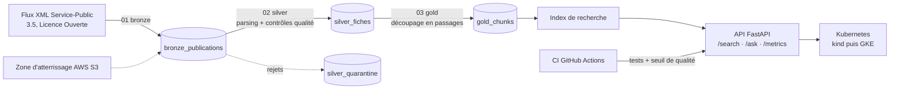

# RAGOps : de la démo à la production

Un assistant documentaire sur les **3 003 fiches pratiques de Service-Public.gouv.fr**, construit comme un système de production plutôt que comme une démo : pipeline de données sur Databricks avec contrôles qualité, API conteneurisée déployée sur Kubernetes, et un **seuil de qualité en CI** qui bloque toute version dont la recherche se dégrade.

Le projet part d'un constat : beaucoup de prototypes d'IA générative brillent en démo puis ne passent jamais en production, faute de données fiables, d'évaluation et d'exploitation. Chaque étape ci-dessous traite l'une de ces causes.

## Architecture



| Couche | Où | Code |
|---|---|---|
| Données (bronze, silver, gold) | Databricks (Free Edition), tables Delta, volumes Unity Catalog | `pipelines/databricks/` |
| Parsing, qualité, découpage | Python, partagé entre Databricks et l'API | `src/ragops/fiches.py`, `quality.py`, `chunking.py` |
| Recherche et évaluation | Référence lexicale TF-IDF, seuil de qualité | `src/ragops/retriever.py`, `evaluate.py`, `eval/questions.jsonl` |
| API | FastAPI, métriques Prometheus | `src/ragops/api.py` |
| Déploiement | Docker, Kubernetes (kustomize, autoscaling), GKE Autopilot | `Dockerfile`, `deploy/k8s/`, `infra/terraform/gcp/` |
| Atterrissage des données brutes | AWS S3 versionné et chiffré, IAM | `infra/terraform/aws/` |

## État d'avancement

- [x] Parsing du flux XML 3.5 : 2 922 fiches de contenu extraites sur 3 003 ; les 81 restantes sont des pages « Recherche guidée » sans contenu propre, exclues avec leur motif
- [x] Contrôles qualité (identifiants, doublons, URL officielles, dates, contenu minimal) avec quarantaine et taux d'erreur toléré
- [x] Découpage en passages et recherche avec sources
- [x] Jeu de 32 questions de référence et seuil de qualité en CI
- [x] API FastAPI (`/search`, `/ask`, `/health`, `/metrics`) et tests (15)
- [x] Notebooks Databricks bronze, silver, gold et définition du job
- [x] Image Docker, manifestes Kubernetes, Terraform GCP et AWS
- [ ] Exécution du pipeline sur Databricks Free Edition
- [ ] Déploiement sur kind, puis sur GKE Autopilot avec Prometheus et Grafana
- [ ] Recherche dense (embeddings + pgvector) et génération LLM, derrière le même seuil
- [ ] Zone d'atterrissage S3 et ingestion depuis S3
- [ ] Article « De la démo à la prod » sur [syllan.dev](https://syllan.dev)

## Résultats actuels

Recherche lexicale (TF-IDF), 32 questions de référence :

| Corpus | hit@1 | hit@3 | MRR@10 |
|---|---|---|---|
| Échantillon de 16 fiches (CI) | 0,91 | 1,00 | 0,95 |
| Corpus complet, 3 003 fiches | 0,44 | 0,75 | 0,58 |

Le chiffre qui compte est celui du corpus complet : c'est la référence que la recherche dense devra battre (objectif : hit@3 ≥ 0,85). Le contrôle qualité a déjà servi : il a signalé 12 fiches dont l'URL pointe vers `entreprendre.service-public.gouv.fr`, un domaine officiel que la première version de la règle refusait à tort.

## Démarrer en local

```bash
python -m venv .venv && source .venv/bin/activate   # Windows : .venv\Scripts\activate
pip install -e ".[dev]"
pytest -q
ragops-eval                                          # seuil de qualité sur l'échantillon
uvicorn ragops.api:app --reload                      # http://127.0.0.1:8000/docs
```

Sur le corpus complet :

```bash
mkdir -p data/raw && curl -L -o data/raw/vosdroits.zip https://lecomarquage.service-public.gouv.fr/vdd/3.5/part/zip/vosdroits-latest.zip
ragops-eval --corpus data/raw/vosdroits.zip --min-hit3 0 --min-mrr 0
RAGOPS_CORPUS=data/raw/vosdroits.zip uvicorn ragops.api:app
```

## Databricks

1. Créer un compte Databricks Free Edition, puis un dossier Git pointant sur ce dépôt.
2. Ouvrir `pipelines/databricks/01_bronze`, `02_silver`, `03_gold` et les exécuter dans l'ordre (paramètres `catalog` et `schema`).
3. Pour l'exécution quotidienne, créer le job décrit dans `pipelines/databricks/job.json` (Workflows).

Si le calcul serverless n'a pas accès à internet, déposer `vosdroits-latest.zip` dans le volume `raw` et laisser `source_url` vide.

## Kubernetes

En local avec kind :

```bash
docker build -t ragops-api:dev .
kind create cluster --name ragops
kind load docker-image ragops-api:dev --name ragops
kubectl apply -k deploy/k8s
kubectl -n ragops port-forward svc/ragops-api 8000:80
```

Sur GKE Autopilot : `terraform -chdir=infra/terraform/gcp apply -var project_id=<projet>`, pousser l'image dans Artifact Registry, puis `kustomize edit set image` et `kubectl apply -k deploy/k8s`.

## Données et licence

Les fiches viennent de [Service-Public.gouv.fr](https://www.data.gouv.fr/datasets/53699fe5a3a729239d206232) (Direction de l'information légale et administrative), sous Licence Ouverte / Etalab 2.0. Les 16 fiches de `data/sample` sont reproduites telles quelles pour les tests. Le code est sous licence MIT.
